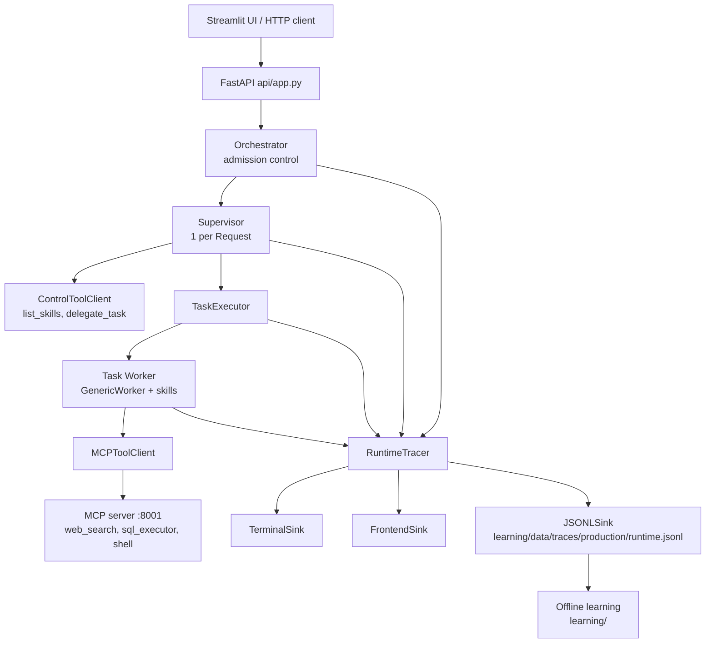

# KernelAI — Repository Index

An architecture map of this repository: what each package is for, how a request
flows through the runtime, how the offline learning loop consumes what the
runtime emits, and where to make a given kind of change.

Generated from the working tree on 2026-10-23. Facts here are derived from the
code, not from intent docs. Where the code and the design notes disagree, this
file describes the code.

---

## 1. What this project is

**KernelAI** is an orchestrated multi-agent runtime plus an offline learning
system.

- A **Request** enters through a FastAPI service.
- A deterministic **Orchestrator** (the "Root") admits Requests and gives each
  one exactly one **Supervisor**.
- The Supervisor is an LLM agent whose only tools are `list_skills` and
  `delegate_task`. It decomposes the Request into independent **Tasks**.
- Each Task is executed by an isolated **Task Worker** agent that receives the
  Task plus the full instructions of the selected **skills**, and only the tools
  those skills grant.
- Tasks in one planning batch run concurrently; outcomes flow back up as bounded
  data.
- Every layer emits structured **RuntimeEvents** through a tracer. Those events
  are rendered live (terminal, UI) and persisted to JSONL, which is the input to
  the **offline learning** pipeline (evaluate → diagnose → propose candidate
  policy; release is manual).

The governing invariant, repeated in `notes.md` and enforced by the code
structure:

> Root manages the system. Supervisor manages the Request. Worker manages the Task.



---

## 2. Top-level layout

| Path | Role |
| --- | --- |
| `api/app.py` | FastAPI service: submit/drive Requests, expose observability and learning dashboards. |
| `orchestrator/orchestrator.py` | Root runtime: Request admission, one Supervisor per Request, lifecycle events. |
| `supervisor/` | Request-level Supervisor runtime + its privileged control tools + role prompt. |
| `tasks/` | `Request`, `Task`, `TaskOutcome` models and `TaskExecutor` (Task → agent). |
| `worker/` | Generic agent runtime (`GenericWorker`), LLM callers, tool clients, agent factory/adapters. |
| `skills/` | Skill registry + full skill instruction documents (`.md`). |
| `mcp_server/` | MCP tool server exposing `web_search`, `sql_executor`, `shell`. |
| `observability/` | Event model, tracer, sinks, sanitization, frontend projection. |
| `learning/` | Offline learning: traces → evaluation → diagnosis → candidate policies → manual release. |
| `ui/` | Streamlit chat UI and two dashboards (observability, offline learning). |
| `tests/` | Pytest suite plus recorded trace fixtures. Most tests are live integration tests, not fakes — see §10. |
| `scripts/` | Dev utilities against the ASU LLM gateway (chat REPL, latency benchmark). |
| `start.sh` | Starts MCP server, FastAPI, Streamlit locally; waits for readiness; cleans up. |
| `scheduler/` | Empty package. Reserved for the future scheduler. |
| `vault/` | Knowledge-vault tree (skills + memory). Tracked files are empty placeholders; `vault/memory` is gitignored. |
| `steps.md`, `step_change.md` | Design/plan documents (phased plan; Stage 0 contract). Historical intent, not current state. |
| `notes.md` | Architecture invariants (gitignored). |
| `prompts.md` | Sample prompts used to exercise multi-task requests. |
| `trace_50.txt`, `context.json` | Local sample trace dumps (`context.json` gitignored). |

---

## 3. Runtime: one Request end to end

### 3.1 Entry — `api/app.py`

- `POST /requests` generates a reserved `request_id`, creates a `RequestRecord`
  with status `submitted`, and runs `execute_request()` via
  `asyncio.create_task`. Submission returns immediately; execution is async.
- `execute_request()` transitions the record `running` → `completed` / `failed` /
  `cancelled` and releases the ID from `active_request_ids`.
- One long-lived `Orchestrator` is shared by all HTTP clients
  (`supervisor_max_iterations=10`, `max_concurrent_requests=5`,
  `max_concurrent_tasks=5`).
- One module-level `RuntimeTracer` fans out to `TerminalSink`, `FrontendSink`
  (live, bounded at 5000 events) and `JSONLSink` writing
  `learning/data/traces/production/runtime.jsonl`.

### 3.2 Admission — `orchestrator/orchestrator.py`

- `submit(request)`:
  - raises if the `request_id` is already in `submitted_request_ids` (IDs are
    reserved before the first `await`, so waiting Requests own their IDs too);
  - awaits `request_semaphore` (`max_concurrent_requests`);
  - runs `_execute_request`, which creates one `Supervisor`, records it in
    `active_requests`, awaits `supervisor.run()`, and emits
    `request_submitted / admitted / completed / failed / cancelled`.
- Every event carries `system_requests`, `active_requests`, `waiting_requests`.
- The Orchestrator never reasons, creates Tasks, or calls LLM/tool APIs.

### 3.3 Request reasoning — `supervisor/supervisor.py`

Construction wires three things:

1. `TaskExecutor` (owns Task → agent execution),
2. `SupervisorControlTools` → `ControlToolClient` (only `list_skills`,
   `delegate_task`),
3. an agent from `worker.factory.create_agent(...)` with
   `worker_role="supervisor"` and `system_prompt = supervisor/supervisor.md`.

`run()` loop:

```
agent.start(query, request_id)
while not agent.is_done:
    agent.run_step()                 # one LLM / control-tool step
    if not pending_tasks: continue
    batch, pending_tasks = pending_tasks, []   # detach this planning batch
    outcomes = await asyncio.gather(*[_execute_task(t) for t in batch])
    store outcomes; append bounded JSON outcomes to agent.messages
```

- Concurrency inside a Request is capped by `task_semaphore`
  (`max_concurrent_tasks`, default 5).
- Only `{task_id, status, result, error}` per Task crosses upward; child Worker
  context and traces stay isolated.
- Emits `supervisor_started`, `supervisor_step_*`, `task_waiting`,
  `task_started`, `batch_started`, `batch_completed`, `task_delegated`,
  `supervisor_completed`, `supervisor_failed`.

**Control tools** — `supervisor/control_tools.py`:

- `list_skills()` → name, description, allowed tools (never full prompts).
- `delegate_task(task, skills[])` → validates non-empty task and skill names,
  resolves each skill through `get_skill()` (unknown skill raises), creates
  `Task(task_id="task_<uuid>")`, registers it in `supervisor.tasks` **and**
  appends it to `supervisor.pending_tasks`, returns only `{"task_id": ...}`.
  It never executes the Task.

### 3.4 Task boundary — `tasks/`

| File | Contents |
| --- | --- |
| `request.py` | `Request(request_id, query)`. |
| `task.py` | `Task(request_id, task_id, query, skill_names, status)`; `TaskStatus` = queued/running/blocked/completed/failed. |
| `outcome.py` | Frozen `TaskOutcome(request_id, task_id, status, result, error)`. |
| `task_executor.py` | `TaskExecutor.execute(task)` — the Task → agent boundary. |

`TaskExecutor.execute()`:

1. Rejects Tasks not in `QUEUED` and Tasks without skills.
2. Loads each skill's `.md` and composes
   `system_prompt = task_worker.md + skill_1.md + skill_2.md + ...`.
3. Computes `allowed_tools` as the **union** of the selected skills' tool grants.
4. Creates an agent (`worker_role="task"`) whose tool client is
   `MCPToolClient()`.
5. `await agent.run(query, request_id, task_id)`; on `ValueError`/`RuntimeError`
   marks the Task `FAILED` and returns a failed outcome instead of raising.

Note: Task-level failures do not propagate as exceptions; the Supervisor sees
them as outcomes and may replan. Exceptions outside those two types do escape.

### 3.5 Agent runtime — `worker/`

| File | Role |
| --- | --- |
| `generic_worker.py` | `GenericWorker`: the only agent implementation. |
| `base.py` | `BaseWorker` ABC (`run(query, request_id)`). |
| `factory.py` | `create_agent()`; backend chosen by `KERNELAI_AGENT` (default `generic`). Unknown backend raises. |
| `adapters/generic.py` | Adapter constructing `GenericWorker`; keeps the runtime independent of the concrete class. |
| `llm_caller.py` | `LLMCaller` — async OpenAI-compatible client for the ASU gateway. |
| `local_llm_caller.py` | `LocalLLMCaller` — Ollama at `localhost:11434/v1`, model `qwen3.5:4b`. |
| `message.py` | `KernelAIResponseContent` pydantic model (`reasoning`, `answer`). Currently unused by `GenericWorker`. |
| `clients/base.py` | `ToolClient` Protocol: `get_tools()`, `call_tool(name, arguments)`. |
| `clients/mcp.py` | `MCPToolClient` — discovers/calls MCP tools over `MCP_SERVER_URL`. |
| `clients/control.py` | `ControlToolClient` — local, explicitly registered tools only; no MCP access. |

`GenericWorker` behavior:

- `start()` seeds messages with the system prompt + query, fetches tools and
  filters them by `allowed_tools` (runtime-enforced capability boundary).
- `run_step()` performs exactly one LLM call. With tool calls it appends the
  assistant message, executes every tool call, and appends `tool` messages.
  With content and no tool calls it sets `result = {"content": ...}` and
  `is_done = True`. Neither content nor tool calls raises `RuntimeError`.
- Iterations are capped by `max_iterations` (10 by default); exceeding it raises.
- Malformed JSON tool arguments produce a `{"ok": false, "error": ...}` tool
  result rather than aborting the iteration.
- Keeps a detailed per-worker `trace` list (printed when `verbose`) separate from
  the shared runtime trace it emits to.

`LLMCaller` reads `ASU_LLM_API_KEY`, `ASU_LLM_BASE_URL`, `ASU_LLM_MODEL` and
sends `extra_body={"chat_template_kwargs": {"enable_thinking": False}}` (the
default model is a hybrid reasoning model; hidden reasoning burns the token
budget).

### 3.6 Capability boundary summary

| Layer | Tool client | Tools available |
| --- | --- | --- |
| Supervisor | `ControlToolClient` | `list_skills`, `delegate_task` only |
| Task Worker | `MCPToolClient` | MCP tools ∩ union of selected skills' `allowed_tools` |

`GenericWorker` filters again on `allowed_tools`, so a skill cannot reach a tool
it did not grant even if the MCP server exposes it.

### 3.7 Skills — `skills/registry.py`

A frozen `Skill(name, description, path, allowed_tools)` with `load()` reading
the full `.md`. Registered today:

| Skill | Doc | Granted tools |
| --- | --- | --- |
| `text2sql` | `skills/text2sql.md` | `sql_executor` |
| `web_search` | `skills/web_search.md` | `web_search` |

`list_skills()` deliberately omits full prompts. Adding a skill = add the `.md`,
add the `Skill` entry, and make sure the MCP tool it names is registered.

**Role prompts** (plain Markdown, loaded verbatim into the system prompt):
`supervisor/supervisor.md` (request decomposition, delegation, replanning) and
`tasks/task_worker.md` (complete exactly one Task, use only granted tools).

---

## 4. MCP tool server — `mcp_server/`

`server.py` creates `MCPServer("KernelAI Tools")`, registers the three tools, and
serves `streamable-http` on `0.0.0.0:8001`.

| Tool | File | Behavior |
| --- | --- | --- |
| `web_search(query, max_results=5, timelimit=None)` | `tools/web_search.py` | DuckDuckGo (`ddgs`) search run in a thread; returns `{success, error, results[{title,url,snippet}]}`. Provider failures come back as structured data, not exceptions. |
| `sql_executor(query)` | `tools/sql_executor.py` | Read-only `asyncpg` query against `DATABASE_URL`; rejects anything not starting with `select`/`with`; returns `{rows, row_count}`. |
| `shell(...)` | `tools/shell.py` | Guarded command execution inside `SHELL_WORKSPACE`: timeout ≤ 300 s (default 120), command ≤ 4,000 chars, output ≤ 100,000 chars, at most 4 concurrent shells, env-var filtering, process-group termination. |

`mcp_server/config.py` is empty.

---

## 5. Observability — `observability/`

| File | Role |
| --- | --- |
| `event.py` | Frozen slotted `RuntimeEvent(timestamp, component, event, request_id, task_id, data)`. |
| `tracer.py` | `RuntimeTracer(sinks).emit(...)`; a failing sink is swallowed so observability never breaks execution. |
| `sinks/base.py` | `TraceSink` Protocol. |
| `sinks/terminal.py` | One fixed-width line per event; values capped for the console. |
| `sinks/jsonl.py` | Appends flattened JSON per line so a trace survives a crash. |
| `sinks/frontend.py` | Thread-safe bounded store (`deque`, 5000) indexed by Request and Task for the UI/API. |
| `sanitize.py` | Redacts secret-looking keys, bounds arguments (4 KiB) and result previews (8 KiB), scrubs secrets out of error text, caps console values (120 chars). |
| `projection.py` | `project_request(events)` → frontend lifecycle state (status, tasks, task workers, current tool, activity, metrics, errors). Pure; no stored projection state. |

`projection.py` is the only place that decides how a raw event stream becomes
display state — the UI and API both go through it, and the JSONL trace remains
the source of truth.

---

## 6. HTTP surface — `api/app.py`

| Method | Path | Purpose |
| --- | --- | --- |
| GET | `/health` | Liveness. |
| POST | `/requests` | Submit a Request; returns immediately. |
| GET | `/requests/{request_id}` | API-facing Request record. |
| GET | `/requests/{request_id}/activity` | Projected per-Task activity. |
| GET | `/requests/{request_id}/events` | Raw retained events for a Request. |
| GET | `/dashboard/requests` | All Request records for the dashboard. |
| GET | `/dashboard/requests/{request_id}` | One dashboard row. |
| GET | `/dashboard/requests/{request_id}/events` | Request events (dashboard shape). |
| GET | `/dashboard/tasks/{task_id}/events` | Task events. |
| GET | `/dashboard/learning` | Aggregated offline-learning state: trace counts, evaluations, metrics, policies, versions, candidates, releases. |

`/dashboard/learning` is assembled in `api/app.py` (`build_learning_dashboard`)
from `learning/data/*` on disk; it computes nothing itself.

---

## 7. UI — `ui/` (Streamlit)

| File | Purpose |
| --- | --- |
| `app.py` | Chat UI: submit requests, poll active ones, render task activity and final answer. |
| `pages/1_Observability.py` | Live observability dashboard over the `/dashboard/*` endpoints. |
| `pages/2_Offline_Learning.py` | **Read-only** presentation of persisted learning state. Never runs the learning pipeline, never mutates anything. |

All three talk to `API_BASE_URL` (default `http://127.0.0.1:8000`) over HTTP and
poll at 1 s. Theme lives in `.streamlit/config.toml` (dark, violet accent).

---

## 8. Offline learning — `learning/`

Flow: **production traces → evaluation → diagnosis → policy candidate →
(separate, manual) release.**

```
learning/data/traces/production/runtime.jsonl
  -> evaluation/loader.py        build ExecutionRecord objects
  -> evaluation/evaluator.py     deterministic + batched semantic metrics
  -> evaluation/aggregator.py    BatchEvaluation (per-metric stats)
  -> learning/tools.py           persist eval_*.json, return aggregates only
  -> supervisor/supervisor.py    LLM diagnoses, inspects outliers/executions,
                                 reads a policy, proposes a candidate
  -> policies/store.py           candidate file (production untouched)
  -> release.py                  manual promotion + rollback snapshot
```

### 8.1 Config and models

- `config/loader.py` + `config/learning.yaml`: global `enabled` switch,
  `minimum_samples`, and per-policy mode (`supervisor: manual_only`,
  `task_worker: disabled`, `web_search`/`text2sql`: `enabled`).
- `models.py`: `LearningMode` (enabled/manual_only/disabled) and `TracePlane`
  (production/learning/evaluation) — planes exist so the learner does not train
  on its own output.

### 8.2 Evaluation pieces

| File | Role |
| --- | --- |
| `evaluation/execution.py` | Immutable `ToolCallRecord`, `TaskExecutionRecord`, `ExecutionRecord` — the stable boundary between runtime observability and evaluation. |
| `evaluation/loader.py` | Groups `runtime.jsonl` events by `request_id` into `ExecutionRecord`s (statuses, timings, token usage, tool calls, extracted query/answer/task descriptions). |
| `evaluation/metrics.py` | `MetricName` enum (completion, verified_success, schema/policy violations, timeouts, failures, tool/LLM calls, tokens, latency, duplicate/retry waste, task_fulfillment, supported/contradicted/unverifiable claim rates, scope_overreach, sufficiency_stopping, policy_compliance, supervisor diagnostics), `MetricSource` (deterministic/model), `MetricResult`. |
| `evaluation/deterministic_calculator.py` | Deterministic per-execution and per-task metrics, incl. exact-duplicate calls and unchanged retries. |
| `evaluation/judge.py` | `SemanticJudge`: one LLM call per semantic metric (task fulfillment, requirement coverage, policy compliance, groundedness, scope overreach, sufficiency stopping). |
| `evaluation/batch_judge.py` | `SemanticJudge` subclass adding `score_batch()`: all normal semantic metrics for N executions in **one** structured-JSON LLM request, keyed back by `request_id`. Used by `evaluate_many`. |
| `evaluation/checkpoint.py` | `EvaluationCheckpoint`: persists completed semantic batches under `learning/data/tmp/ckpt_<id>/` so a failed run resumes instead of re-paying for finished batches. |
| `evaluation/evaluator.py` | `evaluate()` (one execution, semantic metrics concurrently) and `evaluate_many()` (deterministic per execution; stable semantic batches of `batch_size`, optional checkpoint/resume; policy compliance stays per-execution). Executions with no query or no final answer get deterministic metrics only — semantic scores are omitted, never fabricated. |
| `evaluation/aggregator.py` | `aggregate_evaluations()` → `BatchEvaluation` with per-metric mean/median/min/max/count. |
| `evaluation/workload.py` | `EvaluationWorkload`/`EvaluationCase` and `build_workload()`: fixed historical requests replayed against different policy versions. |
| `evaluation/candidate_runner.py` | `CandidateRunner`: replays a workload through isolated runtimes with a candidate policy supplied as text; **never** writes the production policy. |

### 8.3 Learning supervisor and tools

- `supervisor/supervisor.py` (`LearningSupervisor`) + `supervisor/learning_supervisor.md`
  (role instructions: evidence first, aggregate before individual, conservative
  candidates, never touch production).
- `LearningToolClient` exposes exactly six local tools and nothing else:

| Tool | Purpose |
| --- | --- |
| `evaluate_trace_batch(plane, policy?, limit?, checkpoint_id?)` | Evaluate historical executions; persist `eval_*.json`; return aggregates only (individual executions stay out of context). |
| `get_metric_outliers(evaluation_id, metric, direction="lowest", limit=5)` | Find already-scored executions with extreme values for one metric. |
| `get_execution_details(request_id, plane="production")` | Drill into one execution's trajectory. |
| `list_learning_policies()` | Which policies exist and their learning mode. |
| `get_current_policy(policy)` | Read a production policy. |
| `propose_policy_candidate(policy_name, content)` | Snapshot current policy + write an isolated candidate (only for `enabled` policies). |

Tool failures return `{"ok": false, "error": ...}` as tool results instead of
raising, so the supervisor can react.

### 8.4 Policies and release

- `policies/store.py`: resolves known policy names to production files, reads
  current policies, snapshots versions, reads versions and candidates, creates
  candidates. It deliberately exposes **no production write**.
  Production policies today: `supervisor/supervisor.md`, `tasks/task_worker.md`,
  `skills/web_search.md`, `skills/text2sql.md`.
- `release.py`: `release_candidate(policy_name, candidate_id)` — validate, copy
  the current production policy into the release registry, atomically replace the
  policy with the candidate, persist release metadata. Not exposed to the
  learning supervisor.
- `run.py`: `python -m learning.run` runs one learning cycle (`--instruction`,
  `--max-iterations`, `--verbose`, `--local`). It cannot release anything.
- `analysis/`, `security/`, `supervisor/__init__.py` are empty placeholders.

### 8.5 Learning data layout

```
learning/data/
  traces/production/runtime.jsonl   # appended by the API's JSONLSink
  traces/learning/                  # learning-plane traces (empty today)
  traces/evaluation/                # evaluation-plane traces (empty today)
  evaluations/eval_<ts>.json        # persisted batch evaluations
  tmp/ckpt_<id>/                    # transient semantic-batch checkpoints
  candidates/ versions/ registry/ manifests/   # policy artifacts (empty today)
```

`evaluations/eval_*.json` shape: `{evaluation_id, plane, execution_count,
executions: [{request_id, metrics: [{name, source, value, metadata}]}], ...}`.

---

## 9. Scripts and local operation

| Entry point | What it does |
| --- | --- |
| `./start.sh` | Validates the venv/uvicorn/streamlit, starts MCP (`python -m mcp_server.server`, :8001), waits for FastAPI (`uvicorn api.app:app`, :8000) via `/docs`, starts Streamlit (`ui/app.py`, :8501), and kills all three on exit. |
| `python -m learning.run` | One offline learning cycle. |
| `generate_learning_traces.py` | Fires a mixed web-search/text2sql request workload at the API (`--count`, concurrency) to build production traces. |
| `scripts/chat.py` | Interactive chat with the ASU gateway (thinking off by default). |
| `scripts/benchmark_latency.py` | Wall-clock latency stats for the gateway; per-call nonce defeats the gateway's apparent response cache; `--both` compares thinking on/off. |

---

## 10. Test suite — `tests/`

Most of the suite is **live integration**: it needs `.env`, a running MCP server on :8001, the PostgreSQL database, and a reachable LLM gateway. Only three modules are hermetic.

| File | Covers | Needs live services |
| --- | --- | --- |
| `test_observability.py` | Tracer, terminal/JSONL sinks, sink-failure isolation. | No |
| `test_tool_observability.py` | Argument sanitization/redaction, bounded results, tool-call correlation, console caps. | No (fake LLM/tool clients) |
| `test_control_tool_error.py` | `delegate_task` / control-tool failure handling. | No (fakes) |
| `test_orchestrator.py` | Admission, concurrency, duplicate IDs, lifecycle. | Yes |
| `test_supervisor.py` | Delegation, parallel batches, replanning after outcomes. | Yes |
| `test_task_executor.py` | Real text2sql Task execution through `TaskExecutor`. | Yes |
| `test_generic_worker.py` | Worker end-to-end for text2sql and web_search. | Yes |
| `test_local_generic_worker.py` | Same for the local Ollama path. | Ollama at :11434 + MCP |
| `test_mcp_client.py`, `test_mcp_server.py` | MCP discovery/calls; server advertises and runs its tools. | Yes |
| `test_fastapi.py` | Submit/complete/404/concurrent Requests through the app. | Yes |
| `test_observability_api.py`, `test_fastapi_frontend_sink.py` | API endpoints and frontend sink integration. | Yes |
| `test_orchestrator_observability.py`, `test_single_request_parallel_tasks.py` | End-to-end event sequences written to `*.jsonl`. | Yes |
| `test_llm_caller.py`, `test_asu_llm_api.py` | Gateway connectivity (`test_asu_llm_api` skips without `ASU_LLM_API_KEY`). | Yes |
| `test_coding_skill.py` | End-to-end coding request writing into a hardcoded `/Users/.../workspace` path; expects a coding skill the current registry no longer registers, so treat it as legacy. | Yes |
| `learning/test_batch_judge_live.py` | Checkpoint/resume behavior of batched semantic scoring with a fake judge. Despite the name it is a **script**, not a pytest test: it runs via `python tests/learning/test_batch_judge_live.py` (`asyncio.run(run_test())`), because it contains no `test_*` function. | No (fake judge) |

Recorded artifacts kept as fixtures: `tests/coding_skill_trace.jsonl`,
`tests/parallel_50_trace.jsonl`, `tests/single_request_parallel_tasks_trace.jsonl`,
`tests/orchestrator_observability_trace.jsonl`,
`tests/orchestrator_concurrent_results.json`.

Run with `.venv/bin/python -m pytest tests -q` from the repo root
(`conftest.py` loads `.env` for every run). Without the LLM gateway, MCP server
and database running, expect connection failures — run just the hermetic subset
when you only want a quick check:
`pytest tests/test_observability.py tests/test_tool_observability.py tests/test_control_tool_error.py`.

---

## 11. Environment variables

| Variable | Used by | Notes |
| --- | --- | --- |
| `ASU_LLM_API_KEY` / `ASU_LLM_BASE_URL` / `ASU_LLM_MODEL` | `worker/llm_caller.py`, `scripts/*` | Required for real runs; `.env.example` documents them. |
| `MCP_SERVER_URL` | `worker/clients/mcp.py` | e.g. `http://localhost:8001/mcp`. |
| `DATABASE_URL` | `mcp_server/tools/sql_executor.py` | PostgreSQL DSN; not listed in `.env.example`. |
| `SHELL_WORKSPACE` | `mcp_server/tools/shell.py` | Sandbox root for the shell tool. |
| `KERNELAI_AGENT` | `worker/factory.py` | Agent backend; only `generic` exists. |
| `API_BASE_URL` | `ui/*`, `start.sh` | Where the UI finds FastAPI. |
| `KERNELAI_VAULT_PATH` | — | Present in `.env.example` but not read anywhere yet. |

`.env` is gitignored; `conftest.py` loads it before test collection.

---

## 12. Invariants and gotchas

- **Task ≠ step ≠ quantum.** Tasks are semantic units that may span many tool
  calls; quanta/preemption are future work (`tasks/notes.md`, `notes.md`).
- **A batch is one planning step.** `delegate_task` calls made after the batch is
  detached belong to the next batch, so a Supervisor's parallel work is exactly
  what it delegated before awaiting.
- **Only bounded outcomes flow up.** Full child traces are never injected into
  parent context; memory/content retrieval is meant to be on demand.
- **Observability is write-only from the runtime's perspective.** Sink errors are
  swallowed; nothing in `observability/` may change execution.
- **Learning cannot write production.** Candidates are separate artifacts;
  `release.py` is a human action.
- **Secrets never reach traces.** Arguments are redacted by key name and error
  messages are scrubbed against the values that were redacted.
- **Checkpoint paths are CWD-relative.** `EvaluationCheckpoint` roots at
  `learning/data/tmp`, so learning runs must start from the repo root.
- **Empty/legacy areas:** `scheduler/`, `learning/analysis/`, `learning/security/`
  and `vault/skills/**` contain no code or content; `mcp_server/config.py` and
  `worker/message.py` are unused; `BaseWorker.run` omits the optional `task_id`
  that `GenericWorker.run` accepts.

---

## 13. Where to change what

| Goal | Files |
| --- | --- |
| Add a worker capability | new `skills/<name>.md` + entry in `skills/registry.py` + the MCP tool it grants in `mcp_server/tools/` and `mcp_server/server.py`. |
| Change how work is decomposed | `supervisor/supervisor.md` (and `supervisor/control_tools.py` if the tool surface changes). |
| Change Task execution semantics | `tasks/task_executor.py`, `tasks/task_worker.md`. |
| Change agent loop / tool calling | `worker/generic_worker.py` (+ `worker/adapters/generic.py`). |
| Change what is observed | `observability/tracer.py`, `sinks/*`, `projection.py`; emit sites in the runtime layer. |
| Add an HTTP endpoint | `api/app.py`. |
| Change the observability UI | `ui/pages/1_Observability.py`. |
| Change evaluation metrics | `learning/evaluation/metrics.py` + `deterministic_calculator.py` / `judge.py` / `batch_judge.py`. |
| Change learning cost/latency | `batch_judge.py` (prompt + `score_batch`), `evaluator.py` (batch size, checkpointing). |
| Change what the learner may do | `learning/tools.py`, `learning/supervisor/learning_supervisor.md`, `learning/config/learning.yaml`. |
| Change policy storage/release | `learning/policies/store.py`, `learning/release.py`. |

---

## 14. Uncommitted work in the tree at generation time

`git status` shows the batch-evaluation work in progress:

- `learning/evaluation/checkpoint.py` (new) — semantic-batch checkpoint/resume.
- `learning/evaluation/evaluator.py` — `evaluate_many()` with batched scoring and
  checkpoint restore.
- `learning/evaluation/batch_judge.py` — `score_batch()` and its batch prompt.
- `learning/tools.py` — checkpoint plumbing through `evaluate_trace_batch`.
- `learning/supervisor/learning_supervisor.md` — instructions updated for
  batched evaluation.
- `tests/learning/test_batch_judge_live.py` (new) — resume-behavior script.
- `learning/data/tmp/ckpt_2247ace7e3f841a4ad1c08c5124eca38/` — leftover
  checkpoint artifact from a partial run (untracked).
